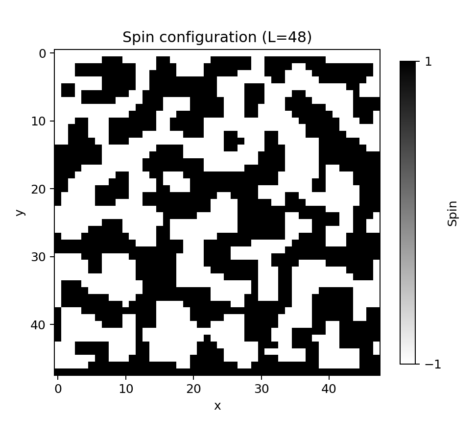
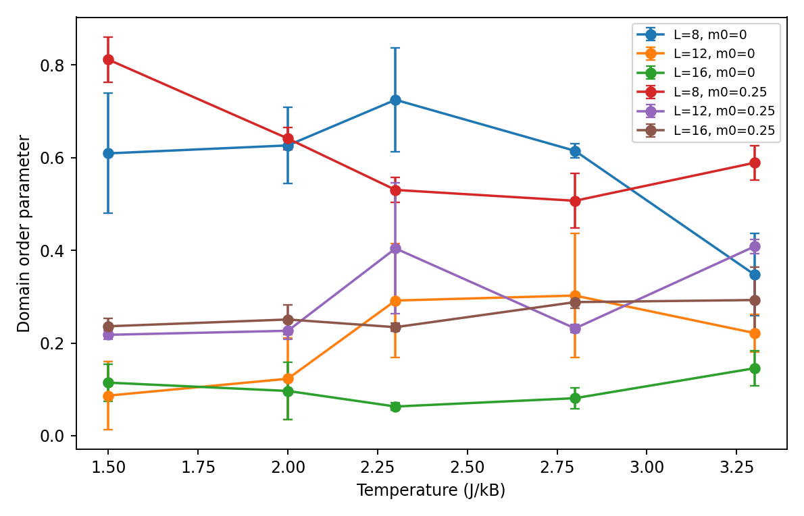
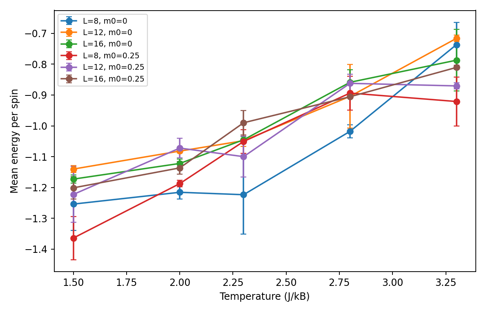
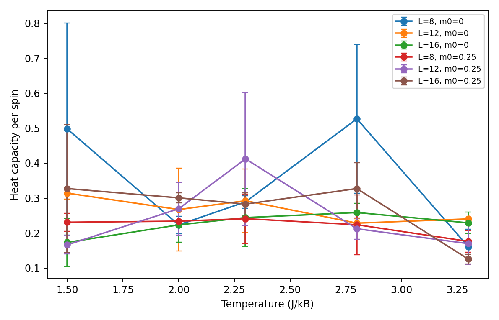

# Kawasaki Dynamics in the Two-Dimensional Ising Model

Monte Carlo simulation of the two-dimensional Ising model with **Kawasaki spin-exchange dynamics**, implemented in **C++17**, with numerical analysis and visualization in **Python**.

Kawasaki dynamics exchanges neighbouring spins rather than flipping individual spins. Consequently, the total magnetization remains constant while the energy fluctuates in accordance with the Metropolis acceptance rule.



The simulation supports configurable boundary conditions, conserved total magnetization and automatic export of measurements.

## Features

- Metropolis Monte Carlo with nearest-neighbour spin exchanges and exactly conserved total magnetization.
- Constant-time local energy-difference calculation for proposed exchanges.
- Periodic boundaries along the horizontal axis; selectable fixed or periodic vertical boundaries.
- Configurable lattice size, temperature, initial magnetization, random seed and sampling schedule.
- Equilibration period separated from measurements; scalar observables and density profiles exported as CSV.
- Automated parameter sweeps, multi-size comparisons and scientific plots.
- CMake build and automated C++/Python tests.

## Model

The square lattice has spins $s_{i,j}\in\{-1,+1\}$ and the nearest-neighbour Hamiltonian

$$
E = -J\sum_{\langle i,j\rangle}s_i s_j, \qquad J=k_B=1.
$$

A proposed exchange of two neighbouring spins is accepted with probability

$$
P_{\mathrm{accept}}=\min\left(1,\exp[-\Delta E/T]\right).
$$

The implementation evaluates $\Delta E$ using only the bonds touching the selected sites, without recalculating the entire Hamiltonian for each attempt. A Monte Carlo sweep corresponds to $L^2$ attempted updates.

The default boundary conditions are periodic in the horizontal direction, with the top row fixed at $-1$ and bottom row fixed at $+1$. Set `--periodic-y 1` to make the vertical direction periodic as well.

## Results

| Observable | Method |
|---|---|
| Magnetization | Mean spin across the lattice; conserved by spin exchange |
| Domain order | Weighted average absolute magnetization of upper and lower domains |
| Mean energy per site | Time average of the Hamiltonian divided by $L^2$ |
| Specific heat per site | $(\langle E^2\rangle-\langle E\rangle^2)/(L^2T^2)$ |
| Density profile | Mean fraction of $+1$ spins by lattice row |
| Domain fluctuation response | $L^2\,\mathrm{Var}(q)/T$, with $q$ the domain-order parameter |

The domain fluctuation response is **not** the conventional uniform magnetic susceptibility: under Kawasaki dynamics, the global magnetization is fixed and its variance vanishes. Finite-sweep plots should not be treated as an accurate determination of the thermodynamic-limit critical temperature.

### Example visualizations



| Energy per site | Specific heat |
|:---:|:---:|
|  |  |

The `data/examples/summary_all.csv` file and figures illustrate the processing workflow with small, deterministic parameter sweeps. The sweep parameters are specified below; larger lattice sizes, longer runs and convergence tests are needed for quantitative critical-point studies.

## Getting started

**Requirements:** C++17 compiler, CMake 3.16 or newer, Python 3.10 or newer.

### 1. Build

```bash
cmake -S . -B build -DCMAKE_BUILD_TYPE=Release
cmake --build build --config Release
```

On Linux/macOS with a single-configuration generator, use `build/kawasaki`. On Windows with Visual Studio use `build/Release/kawasaki.exe`; with MinGW the executable is typically `build/kawasaki.exe`.

### 2. Run a simulation

```bash
./build/kawasaki --L 24 --T 2.3 --m0 0 --sweeps 3000 --burn 1000 --stride 10 --seed 2024 --output outputs/run
```

For **Windows PowerShell** with the Visual Studio generator:

```powershell
.\build\Release\kawasaki.exe --L 24 --T 2.3 --m0 0 --sweeps 3000 --burn 1000 --stride 10 --seed 2024 --output outputs/run
```

The program creates the parent directory of the output prefix automatically and writes:

- `run_summary.csv`: simulation parameters and measured averages.
- `run_timeseries.csv`: sampled observables after equilibration.
- `run_final.csv`: final $L\times L$ spin configuration.
- `run_density.csv`: time-averaged positive-spin fraction at each row.

Run `kawasaki --help` to inspect all parameters. `--m0` is a requested initial magnetization; if lattice constraints prevent an exact value, the realized value is written in the summary.

### 3. Analyse multiple runs

```bash
python -m pip install -r requirements.txt
python scripts/run_sweep.py --exe build/kawasaki --sizes 8 12 16 --temperatures 1.5 2.0 2.3 2.8 3.3 --magnetizations 0 0.25 --replicates 2 --sweeps 300 --burn 100 --stride 5 --out outputs/example
python scripts/plot_results.py --summary outputs/example/summary_all.csv --save outputs/figures
python scripts/estimate_peaks.py outputs/example/summary_all.csv --out outputs/example/peaks.csv
python scripts/plot_lattice.py outputs/example/m+0.00_L16_T1.500_r0_final.csv --save outputs/figures/lattice.png
```

For an individual larger spin-configuration example, use `--L 48 --T 0.65 --sweeps 2500 --burn 500 --stride 20 --seed 2031` with the simulator. Replace `build/kawasaki` with your executable path on Windows. The example sweep uses deterministic random seeds, and its settings are intended to demonstrate the workflow, not produce high-precision estimates.

### 4. Run tests

```bash
ctest --test-dir build --config Release --output-on-failure
python -m pytest -q tests
```

The Python integration tests also exercise the compiled simulator when the environment variable `KAWASAKI_EXE` is set to its executable path. Otherwise, the integration tests are skipped.

## Repository structure

```text
kawasaki-model-simulation/
├── include/kawasaki/lattice.hpp  # Lattice, observables and local energy changes
├── src/kawasaki.cpp             # Simulation program and CSV output
├── scripts/                     # Parameter sweeps, plots and analysis tools
├── tests/                       # C++ and Python verification
├── data/examples/               # Small CSV example
├── figures/                     # Example analysis plots
├── docs/report.pdf              # Computational Physics course report
├── docs/NUMERICAL_METHODS.md    # Methods, definitions and limitations
├── CMakeLists.txt
├── requirements.txt
└── README.md
```

## Academic report

The accompanying [Computational Physics report (PDF)](docs/report.pdf) presents the theoretical background, coursework methodology and figures in Spanish.

## Notes on reproducibility

Random seeds and run settings are recorded in CSV outputs. Sampling is generally autocorrelated; trustworthy uncertainty estimates require sufficient equilibration, independent runs and an assessment of finite-size effects. CSV results are produced locally in `outputs/`, which is excluded from Git.

## License

No open-source license is specified. All rights are reserved unless otherwise stated.
